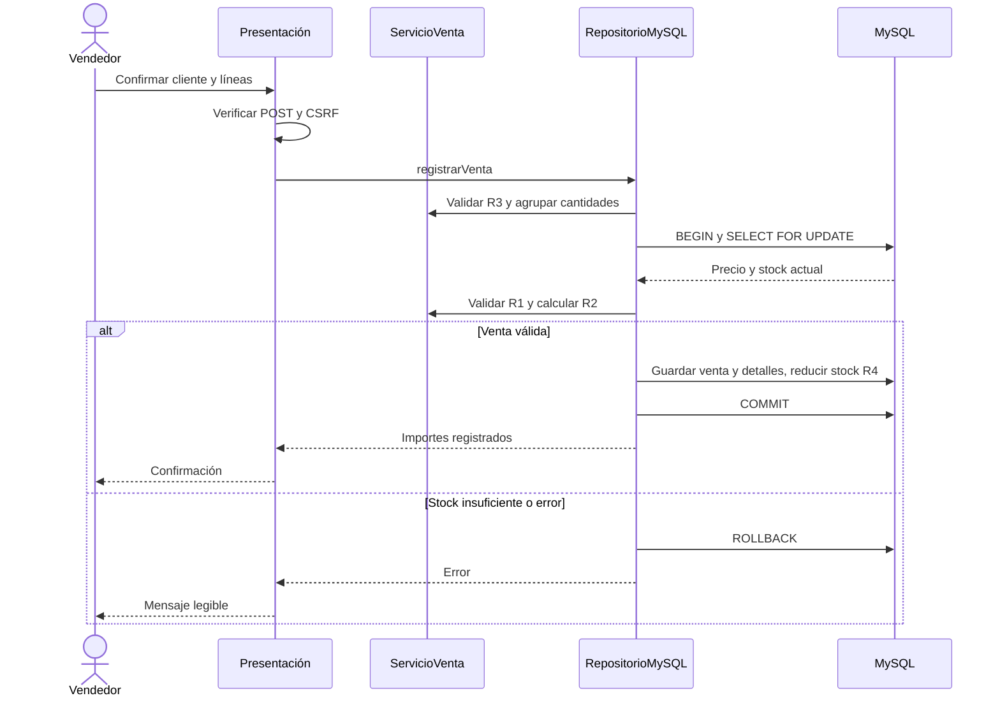

# Diseño de la aplicación

## Capas

| Capa | Archivos | Responsabilidad |
| --- | --- | --- |
| Presentación | index.php, venta.php, guardar_venta.php, resultado.php, assets/ | Formularios, CSRF, mensajes y escape HTML |
| Negocio | src/ServicioVenta.php | R1, R2, R3; cálculos y agrupación de productos sin BD ni HTML |
| Acceso a datos | src/RepositorioMySQL.php, config/conexion.php | PDO preparado, precios desde BD y transacción R4 |

R4 se implementa en el repositorio porque la transacción pertenece a la persistencia. La guía P7 no puede trasladar PDO al servicio sin romper su requisito de aislamiento. El servicio mantiene los cálculos y validaciones de negocio; el repositorio aplica la atomicidad.

## Modelo de datos

| Tabla | Columnas |
| --- | --- |
| producto | id INT PK AI; nombre VARCHAR(80); precio DECIMAL(8,2); stock INT |
| venta | id INT PK AI; fecha DATETIME; cliente VARCHAR(80); subtotal, descuento, total DECIMAL(10,2) |
| detalle_venta | id INT PK AI; venta_id INT FK; producto_id INT FK; cantidad INT; precio_unitario DECIMAL(8,2); importe DECIMAL(10,2) |

Motores InnoDB, claves foráneas y UTF-8. Una venta tiene muchos detalles; cada detalle referencia un producto.

## Secuencia de registrar venta

## Decisiones verificables

validarCantidad(mixed): bool permite validar el POST sin convertir 1.5 a 1. Es una desviación deliberada de la firma int de P5 para cumplir R3. Los métodos de cálculo conservan las firmas indicadas.

Los importes se acumulan en céntimos y el descuento se redondea a dos decimales. Para 100,01 el descuento es 5,00 y el total 95,01. Los productos repetidos se agrupan y bloquean por id ascendente; SELECT FOR UPDATE protege de ventas simultáneas sobre el mismo stock. Nunca se confía en el precio enviado por el navegador.
